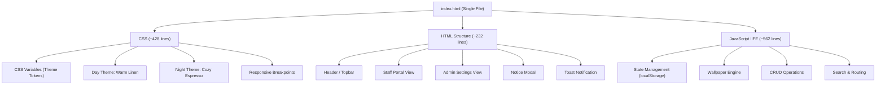

# 📋 Project Analysis — Staff Hub (Office Intranet Portal)

> **File:** [`index.html`](file:///d:/Acer-File/Training/VibeCode/Bitmap Landing Page/index.html) (60 KB, 1263 lines)
> **Type:** Single-page web application (HTML + CSS + JS, all-in-one)
> **Analyzed:** 2026-11-24

---

## 1. Overview

**Staff Hub** is a self-contained office intranet landing page designed as a single HTML file with no external dependencies (aside from Google Fonts). It serves as a customizable portal where employees can access internal services, read announcements, and find quick bookmarks — all with a warm, cozy aesthetic.

> [!IMPORTANT]
> The entire application lives in **one file** — no build tools, no frameworks, no server needed. Just open `index.html` in a browser.

---

## 2. Architecture



---

## 3. Features Breakdown

### 🏠 Staff Portal View
| Feature | Description |
|---|---|
| **Service Launcher** | Card grid of internal services (Nextcloud, ONLYOFFICE, NAS, etc.) with status badges (Online / Maintenance / Offline) |
| **Notice Board** | Categorized announcements (IT Notice, General, Reminder) with pinning, priority levels, and relative timestamps |
| **Quick Bookmarks** | Chip-style links for frequently used resources (Wi-Fi pass, desk booking, leave request, etc.) |
| **IT Helpdesk** | Contact info panel with copy-to-clipboard functionality |
| **Live Clock** | Real-time clock with date and context-aware greeting (morning / afternoon / evening) |
| **Global Search** | Filters services and bookmarks in real-time; keyboard shortcut `/` to focus |

### ⚙️ Admin Panel
| Feature | Description |
|---|---|
| **Portal Identity** | Editable office name, tagline, helpdesk email & phone extension |
| **Service Management** | Full CRUD for services — icon, name, URL, description, status; reorder with ↑↓ |
| **Wallpaper Engine** | Toggle wallpaper on/off, choose source (Lorem Picsum or custom URLs), adjust blur & veil opacity with live-preview sliders |
| **Announcements Admin** | Pin/unpin and delete notices |
| **Bookmarks Admin** | Add/edit/delete bookmarks with URL validation |
| **Backup & Restore** | Export config as JSON, import from file, reset to defaults |

### 🎨 Theming & Visual Design
| Aspect | Detail |
|---|---|
| **Day Theme** | "Warm Linen" — soft cream backgrounds (`#F9F6F0`), warm accent (`#C86D44`) |
| **Night Theme** | "Cozy Espresso" — deep brown tones (`#1B1512`), warmer accent (`#D98E5C`) |
| **Typography** | *Fraunces* (serif, headings) + *Plus Jakarta Sans* (sans, body) via Google Fonts |
| **Wallpaper** | Dual-layer crossfade with drift animations, bokeh gradient fallback, configurable blur & veil |
| **Transitions** | Smooth theme toggle (0.4s), card hover lifts, modal fade-in, toast notifications |
| **Accessibility** | `prefers-reduced-motion` support, `aria` labels, `:focus-visible` outlines, `role="dialog"` on modal |

---

## 4. Technical Details

### State Management
- **Storage:** `localStorage` with key `cozy-intranet-v1`
- **Pattern:** Global mutable `state` object → `save()` serializes to JSON → each render function reads from `state`
- **Defaults:** Factory function `DEFAULTS()` generates fresh state with sample data
- **Merge strategy:** Deep-merges loaded data with defaults to handle missing fields gracefully

### Data Model
```
state = {
  version: 1,
  office: string,
  tagline: string,
  helpdesk: { email, ext },
  theme: "day" | "night" | null,
  wallpaper: { enabled, mode, customUrls[], interval, blur, veil },
  services: [{ id, icon, name, desc, url, status }],
  notices: [{ id, title, body, category, priority, pinned, ts }],
  bookmarks: [{ id, label, url }]
}
```

### Wallpaper Engine
- **Dual-layer crossfade:** Two `div` layers (`bg-layer-a`, `bg-layer-b`) alternate visibility for seamless transitions
- **Sources:** Lorem Picsum (random images) or custom URL list
- **Drift animations:** Subtle `scale` + `translate3d` keyframes (52s and 64s cycles)
- **Fallback:** On image load failure or timeout (8s), a multi-radial-gradient bokeh effect displays
- **Auto-refresh:** Configurable intervals (30s to 15min)

### Routing
- Hash-based: `#portal` (default) vs `#admin`
- View toggle buttons and `hashchange` listener

### Security Considerations
- **XSS protection:** `esc()` helper sanitizes all user content before innerHTML insertion
- **URL validation:** `safeUrl()` restricts links to `http:` and `https:` protocols only
- **Content-editable:** Office name and tagline use `contenteditable` with blur-save pattern

---

## 5. Code Metrics

| Metric | Value |
|---|---|
| **Total lines** | 1,263 |
| **CSS** | ~428 lines (lines 11–428) |
| **HTML** | ~232 lines (lines 430–700) |
| **JavaScript** | ~562 lines (lines 701–1261) |
| **File size** | 60.4 KB |
| **External deps** | Google Fonts only (Fraunces, Plus Jakarta Sans) |
| **Framework** | None (vanilla JS) |
| **Build tools** | None |

---

## 6. Responsive Design

| Breakpoint | Behavior |
|---|---|
| **> 1060px** | Two-column layout (services + notice panel sidebar) |
| **≤ 1060px** | Single-column stack; notice panel unsticks |
| **≤ 720px** | Compact clock, collapsed admin service rows, single-column field grids |

---

## 7. Strengths

- ✅ **Zero dependencies** — no npm, no build, no server; works from a file or any static host
- ✅ **Complete feature set** — CRUD for services, notices, bookmarks; full admin panel
- ✅ **Polished UI** — smooth animations, dual themes, wallpaper engine with graceful fallback
- ✅ **Good accessibility** — ARIA roles, keyboard shortcuts, reduced-motion support
- ✅ **Data portability** — JSON export/import and reset functionality
- ✅ **XSS-safe** — consistent input escaping and URL protocol validation

## 8. Potential Improvements

- ⚠️ **No multi-user support** — data lives in a single browser's localStorage; no sharing across machines without manual export/import
- ⚠️ **No authentication** — the admin panel is accessible to anyone who opens the page
- ⚠️ **innerHTML rendering** — while content is escaped, using DOM APIs (`createElement`) would be more robust against future XSS bugs
- ⚠️ **No drag-and-drop reorder** — services use ↑↓ buttons; drag would be smoother
- ⚠️ **No service health checks** — statuses are manually set, not auto-detected
- ⚠️ **Single-file scalability** — at 1,263 lines, splitting into separate CSS/JS files would improve maintainability
- ⚠️ **No PWA features** — adding a manifest and service worker would enable offline use and home screen install

---

## 9. File Map

```
📁 Bitmap Landing Page/
└── 📄 index.html          ← Entire application (HTML + CSS + JS)
       ├── <style>          Lines 11–428    (CSS themes, layout, components)
       ├── <body>           Lines 430–700   (Portal + Admin views, modal, toast)
       └── <script>         Lines 701–1261  (State, rendering, events, wallpaper)
```
