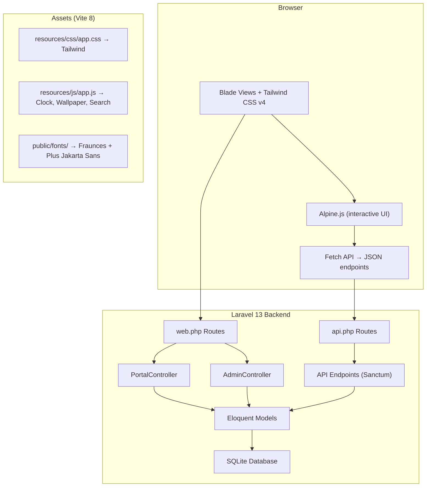

# Implementation Plan — Staff Hub → Laravel + Tailwind CSS Live Website

## Goal
Convert the existing **Staff Hub** single-file HTML intranet portal into a full-stack **Laravel 13 + Tailwind CSS v4** web application, following the exact tech stack and architectural patterns from the [NGCDashboard](file:///D:/Acer-File/Training/VibeCode/NGCDashboard/docs/TECH_STACK.md). The design concept, color palette, typography, animations, and all UI/UX behavior must remain **pixel-identical** to the [original index.html](file:///d:/Acer-File/Training/VibeCode/Bitmap Landing Page/index.html).

> [!IMPORTANT]
> This creates a **brand-new Laravel project** inside `d:\Acer-File\Training\VibeCode\Bitmap Landing Page\` — the original `index.html` will not be modified or deleted.

---

## User Review Required

> [!IMPORTANT]
> **Authentication scope:** The original app has no auth. This plan adds Laravel Session auth (login/logout) to protect the Admin panel, matching the NGCDashboard pattern. The Staff Portal remains public. **Should admin auth be included, or should the app remain fully open?**

#need admin to control some content inside

> [!IMPORTANT]
> **Database engine:** The plan uses **SQLite** (matching NGCDashboard's default). All services, notices, bookmarks, and settings will be stored server-side so any browser can see the same data. The localStorage approach is replaced. **Is SQLite acceptable, or do you want MySQL/MariaDB?**

#just proceed with sqlite

> [!WARNING]
> **Wallpaper images:** The original uses Lorem Picsum (external CDN). Since NGCDashboard follows an air-gapped architecture, this plan keeps Lorem Picsum as the default source but also supports uploading custom wallpaper images to `storage/app/public/wallpapers/`. **Should we keep Lorem Picsum support or go fully offline?**

#yes

---

## Open Questions

1. **Project name** — Should the Laravel `APP_NAME` be `StaffHub`, `Bitmap Intranet`, or something else? #StaffHub looks great
2. **Multi-tenancy** — The original supports one "office". Should the database support multiple offices/portals, or keep it single-tenant? #keep it single
3. **Deployment target** — Will this run on IIS (like NGCDashboard), or a different server?

---

## Architecture Overview



---

## Tech Stack Mapping (NGCDashboard → Staff Hub)

| Layer | NGCDashboard | Staff Hub (New) |
|---|---|---|
| Runtime | PHP 8.3+ | PHP 8.3+ ✅ (8.5 available) |
| Framework | Laravel 13.8 | Laravel 13.8 |
| Auth | Session + Sanctum | Session (admin), Sanctum (API) |
| Database | SQLite | SQLite |
| Templating | Blade | Blade |
| CSS | Tailwind CSS v4 | Tailwind CSS v4 |
| Build | Vite 8 + laravel-vite-plugin | Vite 8 + laravel-vite-plugin |
| Fonts | Self-hosted (public/fonts/) | Self-hosted (Fraunces + Plus Jakarta Sans) |
| Testing | Pest PHP 4.7 | Pest PHP 4.7 |

---

## Proposed Changes

### 1. Project Scaffolding

#### [NEW] Laravel project initialization

```bash
cd "d:\Acer-File\Training\VibeCode\Bitmap Landing Page"
composer create-project laravel/laravel staffhub
```

This creates the full Laravel skeleton. We'll then customize it with the Staff Hub–specific files.

#### [MODIFY] composer.json
Add Sanctum (matching NGCDashboard):
```json
"require": {
    "php": "^8.3",
    "laravel/framework": "^13.8",
    "laravel/sanctum": "^4.0",
    "laravel/tinker": "^3.0"
}
```

#### [MODIFY] package.json
Match NGCDashboard's frontend dependencies:
```json
{
    "private": true,
    "type": "module",
    "scripts": {
        "build": "vite build",
        "dev": "vite"
    },
    "devDependencies": {
        "@tailwindcss/vite": "^4.0.0",
        "concurrently": "^9.0.1",
        "laravel-vite-plugin": "^3.1",
        "tailwindcss": "^4.0.0",
        "vite": "^8.0.0"
    }
}
```

#### [MODIFY] vite.config.js
```js
import { defineConfig } from 'vite';
import laravel from 'laravel-vite-plugin';
import tailwindcss from '@tailwindcss/vite';

export default defineConfig({
    plugins: [
        laravel({
            input: ['resources/css/app.css', 'resources/js/app.js'],
            refresh: true,
        }),
        tailwindcss(),
    ],
});
```

---

### 2. Database Layer

#### [NEW] `database/migrations/xxxx_create_portal_settings_table.php`
Stores the single-row portal configuration (office name, tagline, helpdesk info, wallpaper settings, theme):
```php
Schema::create('portal_settings', function (Blueprint $table) {
    $table->id();
    $table->string('office_name', 60)->default('Nordvik & Co. — Staff Hub');
    $table->string('tagline', 90)->default('A calm place to start the workday.');
    $table->string('helpdesk_email')->default('helpdesk@nordvik.local');
    $table->string('helpdesk_ext', 12)->default('x4210');
    $table->string('theme')->nullable(); // 'day', 'night', or null (auto)
    $table->boolean('wallpaper_enabled')->default(true);
    $table->string('wallpaper_mode', 20)->default('picsum'); // 'picsum' or 'custom'
    $table->text('wallpaper_custom_urls')->nullable(); // JSON array
    $table->integer('wallpaper_interval')->default(300000);
    $table->integer('wallpaper_blur')->default(28);
    $table->integer('wallpaper_veil')->default(55);
    $table->timestamps();
});
```

#### [NEW] `database/migrations/xxxx_create_services_table.php`
```php
Schema::create('services', function (Blueprint $table) {
    $table->id();
    $table->string('icon', 8)->default('🔧');
    $table->string('name', 40);
    $table->string('description', 90)->nullable();
    $table->string('url');
    $table->enum('status', ['online', 'maintenance', 'offline'])->default('online');
    $table->integer('sort_order')->default(0);
    $table->timestamps();
});
```

#### [NEW] `database/migrations/xxxx_create_notices_table.php`
```php
Schema::create('notices', function (Blueprint $table) {
    $table->id();
    $table->string('title', 80);
    $table->text('body')->nullable();
    $table->enum('category', ['general', 'it', 'reminder'])->default('general');
    $table->enum('priority', ['normal', 'high'])->default('normal');
    $table->boolean('pinned')->default(false);
    $table->timestamps();
});
```

#### [NEW] `database/migrations/xxxx_create_bookmarks_table.php`
```php
Schema::create('bookmarks', function (Blueprint $table) {
    $table->id();
    $table->string('label', 40);
    $table->string('url');
    $table->integer('sort_order')->default(0);
    $table->timestamps();
});
```

#### [NEW] `database/seeders/StaffHubSeeder.php`
Seeds the default data from the original `DEFAULTS()` function — 5 services, 3 notices, 5 bookmarks, and 1 portal settings row.

---

### 3. Eloquent Models

#### [NEW] `app/Models/PortalSetting.php`
```php
class PortalSetting extends Model
{
    protected $guarded = ['id'];
    protected $casts = [
        'wallpaper_enabled' => 'boolean',
        'wallpaper_custom_urls' => 'array',
    ];

    // Singleton accessor — always returns row #1
    public static function current(): self
    {
        return static::firstOrCreate(['id' => 1]);
    }
}
```

#### [NEW] `app/Models/Service.php`
```php
class Service extends Model
{
    protected $guarded = ['id'];

    public function scopeOrdered($q) { return $q->orderBy('sort_order'); }
}
```

#### [NEW] `app/Models/Notice.php`
```php
class Notice extends Model
{
    protected $guarded = ['id'];

    public function scopeSorted($q)
    {
        return $q->orderByDesc('pinned')->orderByDesc('created_at');
    }
}
```

#### [NEW] `app/Models/Bookmark.php`
```php
class Bookmark extends Model
{
    protected $guarded = ['id'];

    public function scopeOrdered($q) { return $q->orderBy('sort_order'); }
}
```

---

### 4. Controllers

#### [NEW] `app/Http/Controllers/PortalController.php`
Handles the public **Staff Portal** view:
```php
class PortalController extends Controller
{
    public function index()
    {
        return view('portal', [
            'settings'  => PortalSetting::current(),
            'services'  => Service::ordered()->get(),
            'notices'   => Notice::sorted()->get(),
            'bookmarks' => Bookmark::ordered()->get(),
        ]);
    }
}
```

#### [NEW] `app/Http/Controllers/AdminController.php`
Handles the **Admin panel** (auth-protected):
```php
class AdminController extends Controller
{
    public function index() { /* render admin view with all data */ }
    public function updateSettings(Request $request) { /* validate & save portal_settings */ }
    public function storeService(Request $request) { /* create service */ }
    public function updateService(Request $request, Service $service) { /* update service */ }
    public function destroyService(Service $service) { /* delete service */ }
    public function reorderServices(Request $request) { /* batch update sort_order */ }
    public function storeNotice(Request $request) { /* create notice */ }
    public function updateNotice(Request $request, Notice $notice) { /* toggle pin, etc. */ }
    public function destroyNotice(Notice $notice) { /* delete notice */ }
    public function storeBookmark(Request $request) { /* create bookmark */ }
    public function updateBookmark(Request $request, Bookmark $bookmark) { /* update */ }
    public function destroyBookmark(Bookmark $bookmark) { /* delete */ }
    public function exportConfig() { /* JSON download of all data */ }
    public function importConfig(Request $request) { /* upload & replace */ }
    public function resetDefaults() { /* re-seed all tables */ }
}
```

#### [NEW] `app/Http/Controllers/AuthController.php`
Login/logout for admin access (following NGCDashboard pattern):
```php
class AuthController extends Controller
{
    public function showLogin() { return view('login'); }
    public function authenticate(Request $request) { /* session auth */ }
    public function logout(Request $request) { /* logout & redirect */ }
}
```

---

### 5. Routes

#### [MODIFY] `routes/web.php`
```php
// Public Staff Portal
Route::get('/', [PortalController::class, 'index'])->name('portal');

// Auth
Route::get('/login', [AuthController::class, 'showLogin'])->name('login');
Route::post('/login', [AuthController::class, 'authenticate']);
Route::post('/logout', [AuthController::class, 'logout'])->name('logout');

// Admin (auth-protected)
Route::middleware('auth')->prefix('admin')->name('admin.')->group(function () {
    Route::get('/', [AdminController::class, 'index'])->name('index');
    Route::put('/settings', [AdminController::class, 'updateSettings'])->name('settings.update');

    // Services CRUD
    Route::post('/services', [AdminController::class, 'storeService'])->name('services.store');
    Route::put('/services/{service}', [AdminController::class, 'updateService'])->name('services.update');
    Route::delete('/services/{service}', [AdminController::class, 'destroyService'])->name('services.destroy');
    Route::post('/services/reorder', [AdminController::class, 'reorderServices'])->name('services.reorder');

    // Notices CRUD
    Route::post('/notices', [AdminController::class, 'storeNotice'])->name('notices.store');
    Route::put('/notices/{notice}', [AdminController::class, 'updateNotice'])->name('notices.update');
    Route::delete('/notices/{notice}', [AdminController::class, 'destroyNotice'])->name('notices.destroy');

    // Bookmarks CRUD
    Route::post('/bookmarks', [AdminController::class, 'storeBookmark'])->name('bookmarks.store');
    Route::put('/bookmarks/{bookmark}', [AdminController::class, 'updateBookmark'])->name('bookmarks.update');
    Route::delete('/bookmarks/{bookmark}', [AdminController::class, 'destroyBookmark'])->name('bookmarks.destroy');

    // Backup & Restore
    Route::get('/export', [AdminController::class, 'exportConfig'])->name('export');
    Route::post('/import', [AdminController::class, 'importConfig'])->name('import');
    Route::post('/reset', [AdminController::class, 'resetDefaults'])->name('reset');
});

Route::fallback(fn () => redirect()->route('portal'));
```

#### [MODIFY] `routes/api.php`
```php
// Public API for AJAX search & notice posting
Route::get('/services', fn () => Service::ordered()->get());
Route::get('/notices', fn () => Notice::sorted()->get());
Route::get('/bookmarks', fn () => Bookmark::ordered()->get());
Route::get('/settings', fn () => PortalSetting::current());

// Protected API for admin operations
Route::middleware('auth:sanctum')->group(function () {
    Route::post('/notices', [AdminController::class, 'storeNotice']);
});
```

---

### 6. Blade Views

All views replicate the **exact HTML structure** and class names from the original `index.html`, but translated to Blade templating with Tailwind utility classes layered on top of the custom CSS.

#### [NEW] `resources/views/layouts/app.blade.php`
Master layout with:
- `@vite(['resources/css/app.css', 'resources/js/app.js'])`
- Self-hosted fonts (Fraunces + Plus Jakarta Sans from `public/fonts/`)
- `<div id="bg-wrap">` wallpaper layers
- `@yield('content')` slot
- Toast notification element

#### [NEW] `resources/views/portal.blade.php`
The Staff Portal — extends `layouts/app`:
- Header with editable office name/tagline (now server-rendered)
- Live clock (JS, same logic)
- Service launcher grid (Blade `@foreach` over `$services`)
- Notice board with category tabs (Blade + minimal JS filtering)
- Quick bookmarks chips
- IT Helpdesk panel
- Search input (JS-driven client-side filter, no page reload)

#### [NEW] `resources/views/admin.blade.php`
The Admin panel — extends `layouts/app`:
- Portal Identity & Helpdesk form (`PUT /admin/settings`)
- Service manager with inline editing
- Wallpaper configuration
- Announcements manager
- Bookmarks manager
- Backup & Restore buttons

#### [NEW] `resources/views/login.blade.php`
Simple login form matching the warm linen aesthetic.

#### [NEW] `resources/views/components/notice-modal.blade.php`
Blade component for the "Post a notice" modal.

---

### 7. Frontend Assets

#### [MODIFY] `resources/css/app.css`
```css
@import 'tailwindcss';

/* ============================================================
   Staff Hub — "Warm Linen" daylight / "Cozy Espresso" night
   Exact CSS custom properties from the original index.html
   ============================================================ */

@theme {
    --font-sans: 'Plus Jakarta Sans', ui-sans-serif, system-ui, sans-serif;
    --font-serif: 'Fraunces', Georgia, serif;
}

/* All :root and [data-theme="night"] custom properties preserved exactly
   from the original — colors, shadows, radii, blur values */
:root { /* ... all original CSS variables ... */ }
[data-theme="night"] { /* ... all original night-mode variables ... */ }

/* All component styles (.topbar, .svc, .notice, .chip-link, etc.)
   preserved exactly from lines 122–428 of the original */
```

> [!NOTE]
> The entire original CSS (~428 lines) is preserved verbatim inside `app.css` alongside the Tailwind import. This ensures **pixel-identical** rendering while still enabling Tailwind utilities in Blade views.

#### [MODIFY] `resources/js/app.js`
Client-side JavaScript for:
- **Clock** — live time, date, greeting (same logic)
- **Theme toggle** — sends preference to server via API, updates `data-theme`
- **Wallpaper engine** — dual-layer crossfade, drift animations, bokeh fallback (same logic)
- **Search** — client-side filtering of service cards and bookmark chips
- **Copy-to-clipboard** — helpdesk email/ext
- **Notice modal** — opens modal, submits via `fetch()` POST to API
- **Toast** — notification display

#### [NEW] `public/fonts/Fraunces/` and `public/fonts/PlusJakartaSans/`
Self-hosted font files (downloaded from Google Fonts) for offline operation.

#### [NEW] `public/css/fonts.css`
`@font-face` declarations for both font families, following NGCDashboard's pattern.

---

### 8. Configuration

#### [MODIFY] `.env`
```env
APP_NAME=StaffHub
APP_ENV=local
APP_URL=http://localhost:8624

DB_CONNECTION=sqlite
# DB_DATABASE will default to database/database.sqlite

SESSION_DRIVER=database
CACHE_STORE=database
QUEUE_CONNECTION=database
```

---

## File Tree (New Project)

```
staffhub/
├── app/
│   ├── Http/Controllers/
│   │   ├── AdminController.php          [NEW]
│   │   ├── AuthController.php           [NEW]
│   │   ├── Controller.php               (scaffold)
│   │   └── PortalController.php         [NEW]
│   ├── Models/
│   │   ├── Bookmark.php                 [NEW]
│   │   ├── Notice.php                   [NEW]
│   │   ├── PortalSetting.php            [NEW]
│   │   ├── Service.php                  [NEW]
│   │   └── User.php                     (scaffold)
│   └── Providers/
│       └── AppServiceProvider.php       (scaffold)
├── database/
│   ├── migrations/
│   │   ├── xxxx_create_portal_settings_table.php   [NEW]
│   │   ├── xxxx_create_services_table.php          [NEW]
│   │   ├── xxxx_create_notices_table.php           [NEW]
│   │   └── xxxx_create_bookmarks_table.php         [NEW]
│   └── seeders/
│       ├── DatabaseSeeder.php           [MODIFY]
│       └── StaffHubSeeder.php           [NEW]
├── public/
│   ├── css/
│   │   └── fonts.css                    [NEW]
│   └── fonts/
│       ├── Fraunces/                    [NEW]
│       └── PlusJakartaSans/             [NEW]
├── resources/
│   ├── css/
│   │   └── app.css                      [MODIFY] — Tailwind + all original custom CSS
│   ├── js/
│   │   └── app.js                       [MODIFY] — Clock, wallpaper, search, toast
│   └── views/
│       ├── layouts/
│       │   └── app.blade.php            [NEW]
│       ├── components/
│       │   └── notice-modal.blade.php   [NEW]
│       ├── admin.blade.php              [NEW]
│       ├── login.blade.php              [NEW]
│       └── portal.blade.php             [NEW]
├── routes/
│   ├── api.php                          [MODIFY]
│   └── web.php                          [MODIFY]
├── .env                                 [MODIFY]
├── composer.json                        [MODIFY]
├── package.json                         [MODIFY]
└── vite.config.js                       [MODIFY]
```

---

## Execution Phases

### Phase 1 — Scaffold & Infrastructure
1. Create Laravel project via `composer create-project`
2. Configure `.env` (SQLite, app name)
3. Install npm dependencies (Tailwind v4, Vite 8)
4. Download & self-host Fraunces + Plus Jakarta Sans fonts
5. Configure `vite.config.js`

### Phase 2 — Database & Models
1. Create all 4 migrations
2. Create all 4 Eloquent models
3. Create seeder with default data
4. Run `php artisan migrate --seed`

### Phase 3 — Controllers & Routes
1. Create `PortalController`, `AdminController`, `AuthController`
2. Define `web.php` and `api.php` routes
3. Create default admin user via seeder

### Phase 4 — Frontend (Views + CSS + JS)
1. Create `layouts/app.blade.php` master layout
2. Port the Staff Portal HTML → `portal.blade.php` (Blade loops, escaped output)
3. Port the Admin panel HTML → `admin.blade.php` (forms with CSRF, method spoofing)
4. Create `login.blade.php`
5. Port all CSS to `resources/css/app.css` (Tailwind import + original custom CSS verbatim)
6. Port JS to `resources/js/app.js` (clock, wallpaper engine, search, toast, modal)

### Phase 5 — Verification & Polish
1. Run `npm run build` — verify Vite compilation
2. Run `php artisan serve --port=8624` — visual verification
3. Run `php artisan test` — Pest tests
4. Test full CRUD flow: services, notices, bookmarks
5. Test theme toggle, wallpaper, search, export/import

---

## Verification Plan

### Automated Tests
```bash
cd staffhub
php artisan test
```

Tests to create:
- **Feature/PortalTest.php** — `GET /` returns 200, contains service names, notices, bookmarks
- **Feature/AdminTest.php** — Auth-protected routes return 302 for guests, 200 for auth users
- **Feature/ServiceCrudTest.php** — Create, update, reorder, delete services
- **Feature/NoticeCrudTest.php** — Create, pin/unpin, delete notices
- **Feature/BookmarkCrudTest.php** — Create, update, delete bookmarks
- **Feature/BackupRestoreTest.php** — Export returns JSON, import replaces data, reset re-seeds

### Manual Verification
1. Open `http://localhost:8624` — confirm the portal looks **identical** to the original `index.html`
2. Toggle day/night theme — confirm colors match original
3. Click shuffle wallpaper — confirm crossfade animation works
4. Search for a service — confirm real-time filtering
5. Post a notice via modal — confirm it appears on the board
6. Open Admin panel — CRUD all entities
7. Export config → Reset → Import config — confirm round-trip works
8. Test on mobile viewport (≤720px) — confirm responsive behavior matches original
